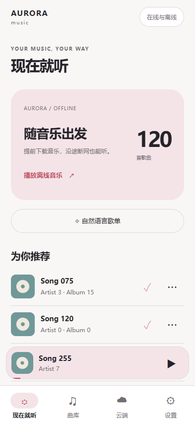
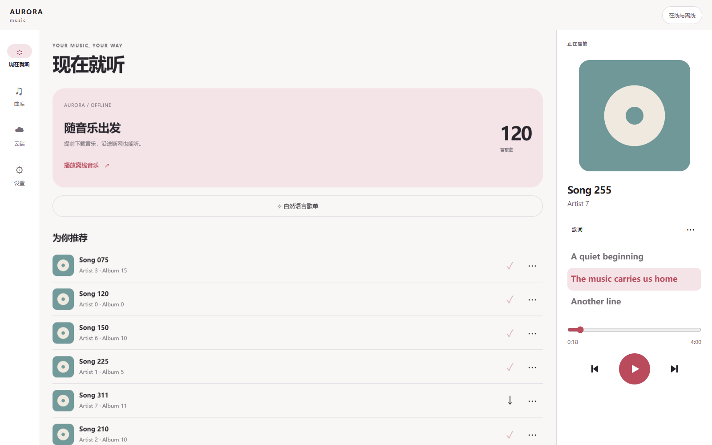
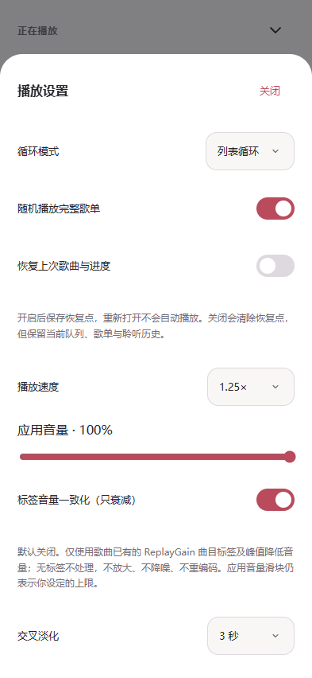
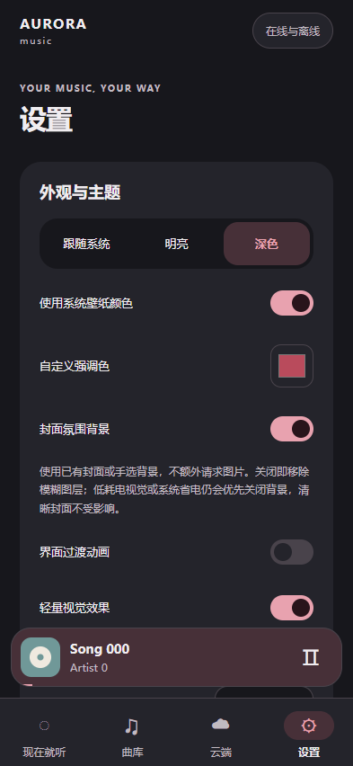
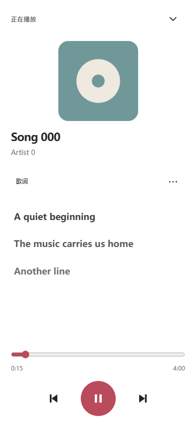
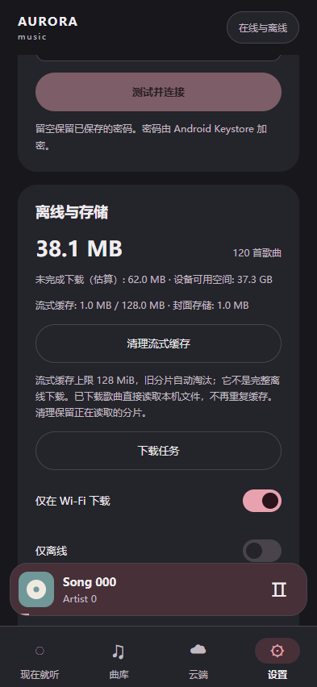
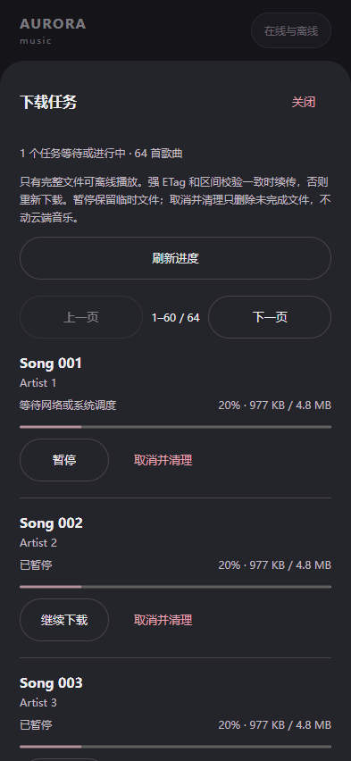
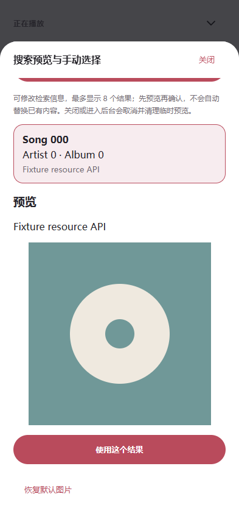
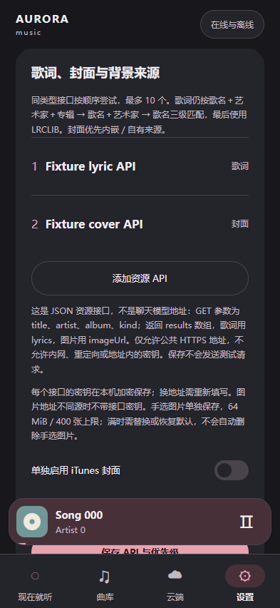

# Aurora Music Android · 预览版

[简体中文](README.android.md) · [繁體中文](docs/android/guide.zh-TW.md) · [English](docs/android/guide.en.md) · [Français](docs/android/guide.fr.md)

同一仓库维护 Windows 和 Android 两个入口：Windows 使用 Electron，Android 使用响应式 React 界面与原生 Media3、SQLite、WorkManager。适配目标是小米 14 Ultra 和小米 Pad 8 Pro。

当前 Android 版本为 **1.5.0-preview.11（versionCode 17）**。改为全屏歌词播放器，缩小封面并将歌曲详情、资源查找和播放设置收进「更多操作」；设置选择菜单与开关统一为应用内主题。补充常见中文文件名的歌手／歌名推断，重扫不会覆盖已有标签或手动修改。保留此前音频、缓存与小组件修复。Android 16 隔离模拟器验证了短时后台服务、两种小组件控制入口及公开 MP3/AAC 的解码、跳转和缓存，但这不等于小米桌面布局、长时间息屏或你的 WebDAV 验收。你反馈的特定 M4A 播放问题本轮按要求延期，没有宣称修好。请覆盖安装后真机复测；完整进度见 [功能与验收清单](docs/ANDROID_REQUIREMENTS.md)。

本次修正播放／暂停图标在圆形按钮内偏左的问题，三个控制按钮统一居中；不改动播放、解码或缓存逻辑。

## 界面

下图来自隔离的演示曲库与模拟原生接口，不是小米真机截图。设置可切换简体、繁体、英语、法语。





## 已实现

- WebDAV 连接、目录浏览与递归索引；完整曲库搜索和分页，不再把前 10,000 首当作整库。歌曲、专辑、艺术家、收藏和类型浏览均可形成完整播放队列。
- 原生后台／锁屏播放、媒体通知、音频焦点和拔出耳机暂停。播放队列保存在 SQLite，Media3 只保留约 40 首的窗口；恢复歌曲和进度时保持暂停。
- 手动和智能规则歌单、本地行为偏好；可用自然语言生成例如“40 分钟夜跑歌单”。日常推荐使用有界候选池；自然语言歌单逐页检索完整曲库。
- 可选多 API：DeepSeek、Chat Completions、Responses、Anthropic、Gemini；按优先级回退，失败保留本地结果。最多 10 个服务，API Key 使用 Keystore 加密。
- 自动歌词按“歌名＋艺术家＋专辑 → 歌名＋艺术家 → 歌名”匹配；封面保守匹配，优先使用已有封面。可编辑歌词；歌词支持点击跳转。
- 资源 API 支持独立密钥、优先级和启停；歌曲详情中搜索、预览、确认歌词／封面／背景，手选封面不被音频标签覆盖。iTunes 默认关闭、单独开启；默认图片检索只用内嵌、自有和已配置来源。
- 封面模糊背景、系统／明亮／深色主题、壁纸动态色、自定义强调色、减少动画和低耗电视觉。默认低耗电视觉关闭大面积模糊。
- 「封面氛围背景」可独立关闭，直接移除模糊图层而不隐藏清晰封面；仍优先服从低耗电视觉／系统省电，不增加图片查询。
- 二级歌曲详情、源文件编码／码率／采样率；播放设置包含列表／单曲循环、完整歌单随机、0.5–2× 倍速、应用音量和睡眠定时器。
- 默认关闭的 ReplayGain 曲目标签音量一致化：只衰减、不放大，峰值标签可进一步限制音量；无可用标签不处理。不重编码、不额外扫描文件、不使用后台网页计时器。标签数据只在二级歌曲详情显示。
- 默认关闭的 1／2／3 秒原生交叉淡化：曲尾和手动切歌共用两路衔接，通知／小组件／耳机控制走同一入口。辅助播放器只在准备或淡化期间存在，慢网或失败时退回普通切换；实际听感仍待真机验收。
- 两种可调整大小的原生桌面小组件：歌曲型和歌词型。歌词仅在亮屏换行时更新，不用后台网页计时器。
- 离线文件直接流式写入应用私有目录，完成后原子重命名；不会另复制一整份。有 Wi-Fi 限制、完整性检查、重试和空间预留；新增分页任务列表、进度、暂停、续传、重试和取消清理。
- 流式缓存单独显示占用，上限 128 MiB、自动淘汰旧分片；可手动清理，保留正在读取的缓存。离线歌曲不再重复进入流式缓存；清理不会删除离线歌曲、封面、歌单或历史。
- 可选「提前缓存下一首」：当前播放缓冲稳定后尝试缓存下一首完整文件，已知大小须不超过 64 MiB，与播放共用上述缓存，不另存离线副本。暂停、切歌、缓冲、省电或网络策略变化时取消；默认关闭。
- 歌词字号可选 18／24／30／36，同时支持系统字体缩放；可关闭歌曲／进度恢复，保持当前队列和聆听历史。主题设置快速连续修改时按顺序保存，避免相互覆盖。

“可用听歌设备”列出系统可见输出，不代表当前输出路线、蓝牙编码或实际采样率。应用不默认添加增益／降噪，不能靠换格式还原丢失的录音细节。




## 在 Android Studio 编译

需要 Node.js 22、JDK 21、Android SDK Platform 36 和 Build Tools 36。Android Studio 可管理 SDK；Gradle JDK 请选择 21，不要只凭 IDE 自带 JDK 的名称判断版本。

1. 解压源码，找到同时含有 `package.json`、`mobile/`、`src/`、`android/` 的项目根目录。
2. 在根目录打开终端，首次执行：

   ```powershell
   npm ci
   npm run android:sync
   ```

3. 在 Android Studio 点 **Open**，选这个项目的 **android 文件夹**，不要另建空项目。
4. 在 Gradle 设置中选择 JDK 21；SDK Manager 安装 Platform 36 和 Build Tools 36。等待 Gradle Sync 完成，必要时允许下载依赖。
5. 构建 debug APK；也可以在 Android Studio 的终端执行：

   ```powershell
   .\gradlew.bat :app:assembleDebug :app:testDebugUnitTest :app:lintDebug
   ```

产物：`android/app/build/outputs/apk/debug/app-debug.apk`。安装到手机和平板即可开始验证。修改 `mobile/` 或共享 TypeScript 后，须在根目录重新执行 `npm run android:sync` 再构建；只点 Android Build 不会自动更新网页部分。

## 通过 GitHub 编译

上传解压后的源码内容，不是一个 ZIP 文件。保留隐藏的 `.github/` 及 `android/`、`mobile/`、`src/`、依赖锁文件。仓库 **Actions → Android debug APK → Run workflow**；成功后下载 `aurora-android-debug` Artifact，解压出 APK。

不要提交 API Key、WebDAV 凭据、个人数据库、SDK/JDK、缓存、debug／release 签名密钥。工作流现在只构建和检查，不会自动发布到商店，也没有执行小米硬件测试。

长期分发使用新增的 **Android signed APK** 手动工作流，同一私有密钥及公开指纹须提前由你配置。它不自动发布，只上传经过校验的 APK 和校验 JSON；缺少配置、debug 密钥或签名不一致会拒绝。步骤见[四语言签名指南](docs/android/release-signing.md)。本次没有生成或上传你的正式密钥。

## 不卸载直接更新

同一应用 ID、相同签名证书和合适的 versionCode 可以覆盖安装，保留本地数据。正式发行必须长期保存同一套私有签名。

固定签名构建配置与校验已接入，实际 GitHub 执行和真机覆盖仍须验证。新 release 密钥不能自动覆盖旧 debug 包；不要为了使用新流程卸载现有应用。

不同电脑、不同 GitHub 构建或旧 debug 包可能使用不同签名。出现“签名不一致”不要自动卸载，也不要清数据；先找到原签名重新构建。当前没有完整的数据导出／迁移界面，卸载可能丢失曲库、歌单、凭据和离线歌曲。本次未替换你以前发布的安装包或源码 ZIP。

## 使用与火车出行

1. 设置填 HTTPS WebDAV 音乐目录、用户名、密码，连接后在“云端”扫描曲库。不接受自签名证书。播放和离线下载支持最多 5 次 HTTPS 下载跳转；离开原 WebDAV 目录后，仅允许公网地址且移除所有 WebDAV 授权／Cookie，不向 CDN 发送账号密码。拒绝 HTTP 降级、内网目标和循环跳转；目录和资源 API 的限制没有放宽。
2. 出行前在 Wi-Fi 下载需要的歌曲。只有完整文件被标为离线；切到“仅离线”，关网试播一遍，别把流式缓存当作完整下载。
3. 新下载任务遵守 Wi-Fi 开关。设置 →「下载任务」可查看进度、暂停／继续／重试／取消并清理。暂停保留临时文件；取消清理只针对本机未完成文件，保留云端音乐和已经完成的离线文件。
   续传必须有相同的强 ETag 和正确字节区间；文件变化、服务器忽略区间或缺少可靠校验标识时会安全重下。临时文件占用单独估算显示，任务页每页 60 首，关闭或切后台后停止进度轮询。
   网络恢复后由系统安排重试，并非即时或永久后台下载保证；连续五次无净进展的错误会停止自动重试，可手动重试。Android 调度可能延迟，超慢的大文件仍须真机验证。不保证未下载歌曲在长时间断网后继续。
4. HyperOS 应用设置允许后台运行、设为不限制电池；可按需锁定最近任务。后台服务不是“永远不被杀”的保证，强制停止会结束播放。
5. 桌面长按 → 小组件 → Aurora，选择歌曲或歌词样式。直接添加不被桌面支持时可手动添加；大小和权限需在设备上确认。
6. 全屏播放器 →「⋯ 更多操作」→「播放设置」，或设置 →「播放与听歌设备」。睡眠计时运行在原生服务，结束时暂停；进程终止后不恢复计时，重新打开应用不自动开播。
7. 设置 →「清理流式缓存」只释放未使用分片；正在读取的缓存会提示保留，可切换歌曲后再清理。这里的 128 MiB 上限是磁盘缓存，不是应用内存。完整离线音乐和封面仍保留，缓存不能替代出行前下载。
8. 设置 →「歌词字号」调整显示；「播放与听歌设备」中关闭「恢复上次歌曲与进度」会清除恢复点，但不删队列、收藏、歌单和历史。重新开启从当前播放保存新恢复点，不找回已清除的旧进度。

点击底部歌曲进入全屏播放器：封面较小，歌词占主要区域；点击歌词跳到该句，点击「歌词」回到当前行。图片背景需同时开启「封面氛围背景」并关闭「低耗电视觉」；系统省电仍优先关闭模糊和动画，不为背景额外请求图片。更多菜单、播放设置和选择弹层按返回手势逐层关闭。选择菜单按关闭／返回不会更改当前值；播放设置仍须按「保存」才应用。



曲库重扫时，`周杰伦-星晴.m4a` 和 `Artist - Song.mp3` 等常见文件名可作为信息兜底。只修复艺术家仍为空且歌名仍是原始文件名的旧条目；已读标签、手动改名、收藏、歌词和离线文件保持不变。不猜测专辑，未知专辑仍归入「未知专辑」；多连字符或英文无空格名称保持原样，避免把歌曲标题误当歌手。这是文件名推断，不代表已读取真实音频标签。

「播放与听歌设备」→「标签音量一致化（只衰减）」→ 保存，可使用已有 ReplayGain 曲目增益／峰值标签。支持 MP3 TXXX、FLAC/Vorbis 注释及 M4A 的 iTunes 自由标签；不把专辑增益、R128、Opus 头增益或 Sound Check 再次应用。缺失、异常和超出安全范围的值忽略，不猜测 0 dB。应用音量仍是你选择的上限，切歌会清除上一首系数。它不会放大偏安静的歌曲，也不是底噪消除或音质修复。可在歌曲详情查看标签，关闭即可恢复原有应用音量。

同一对话框内的「提前缓存下一首」也须开启并保存，默认不连网预取。它等待当前播放不再加载、稳定 5 秒后，在原生后台尝试缓存下一首完整文件；仅处理已知大小、最多 64 MiB 的在线歌曲，跳过已下载歌曲和正在排队／下载的任务。预取不调用 AI，不产生「已离线」标记；缓存可被系统或播放器淘汰，火车出行仍请提前下载。

「交叉淡化」可选关闭／1／2／3 秒，保存后生效。接近曲尾才准备下一首，手动切歌最多等 8 秒，未就绪就正常切换；单曲循环、直播、过短或时长未知的歌曲不自动重叠。暂停、拖动进度、关闭或系统省电时结束淡化；准备中暂停仍保留你选择的歌曲，但不自动开播。两路共用焦点与降低音量逻辑，线性音量系数总和不超过应用音量上限；这是控制规则，不是已测得无失真。缓冲区仍有界，不把整曲解码进内存，但短暂增加一个解码器和耗电，也可能增加移动流量。默认关闭最省资源，不影响普通播放与离线下载。

预取遵守下载的 Wi-Fi／非计量限制，关闭该限制后可能消耗移动流量。暂停、切歌、当前播放重新加载或缓冲、系统省电、网络变化和关闭开关会取消网络请求；单次最长 90 秒，无连续失败重试。清理缓存后，当前歌曲期间不重新预取。共用 128 MiB 已提交分片额度，另留当前播放空间；写入分片最多 2 MiB，尚未提交分片和索引有额外磁盘开销，这不是内存上限。升级后缓存键加入源文件大小／修改时间，旧流式片段可能需重取，但旧缓存仍按额度淘汰，完整离线文件不变。




## 能看到歌曲，但播放失败？

覆盖安装本版，不要卸载、清空数据或删除曲库。先尝试一首 MP3，再尝试 M4A；点击底部歌曲打开播放器，可看到四语言说明与 `AUDIO_…` / Media3 错误码。失败后点击一次「播放」重试，不会不停自动重试或后台轮询。

- `AUDIO_HTTP_401` / `403`：服务器拒绝下载；能列目录不代表有下载权限，检查 WebDAV 服务、账号和下载权限后重新连接。
- `AUDIO_NETWORK` / `TIMEOUT` / `TLS`：网络、响应超时或证书问题；不会关闭证书验证来绕过错误。
- `AUDIO_REDIRECT_…` / `NOT_AUDIO` / `RANGE`：下载跳转、服务器返回网页／错误信息或字节区间不正确。
- `AUDIO_FORMAT` / `DECODER`：读取到文件后才遇到的容器／解码问题，不能与所有歌曲的网络失败混为一谈。

若仍失败，反馈新错误码、文件格式和设备／系统版本即可。Android Studio Logcat 可筛选 `AuroraPlayback` 查看同样的安全错误码；不要提供账号密码、签名下载链接或原始服务器响应。本地自动化测试不使用你的真实服务器，仍需你复测实际播放、拖动进度、离线下载及断网试播。

## API、歌词与隐私



本地推荐无需 API。在设置添加服务的 URL、准确模型 ID、Key，再调整优先级。Responses 与 Chat Completions 是两个选项，应与提供方实际支持的接口一致，程序不猜测或替换模型 ID。

自然语言歌单默认为本地模式。勾选 AI 才发送提示词、偏好摘要和少量候选歌曲元数据，不发送音频、WebDAV 地址、原始播放历史或凭据。失败回退可能让多个服务收到请求并计费；关闭生成页或切后台会取消尚未完成的请求，但不能撤销已处理的费用。

歌词按「歌名＋艺术家＋专辑 → 歌名＋艺术家 → 歌名」三级寻找，每一级按优先级尝试已启用的歌词 API，再用 LRCLIB。设置 →「歌词、封面与背景来源」最多配置 10 个服务，支持独立 Bearer Key、排序和启停；这是 JSON 资源接口，不是聊天模型地址。保存不会发送测试请求，密钥加密保存且不回传界面；换 URL 要重新填 Key。

封面优先内嵌、自有和已配置来源；iTunes 默认关闭，需单独确认开启。开启不代表获得图片授权，使用前请阅读 [Apple 接口条款](https://performance-partners.apple.com/search-api)。背景默认由封面放大模糊，无额外请求；配置背景 API 后也可手动选择独立背景。

歌曲详情 →「搜索预览与手动选择」可修改检索信息，最多 8 个结果。点击才下载图片预览，确认「使用这个结果」才替换该资源，其他资源、音频、歌单和历史不变。手选封面不被随后读取的音频标签覆盖。关闭或进入后台取消并清理临时预览；凭证 10 分钟失效，须重新搜索。恢复默认只清理对应手选图片，不修改云端音乐。




资源 API 使用 GET 参数 `title`、`artist`、`album`、`kind`，返回 `results` 数组，歌词字段 `lyrics`，图片字段 `imageUrl`。仅公共 HTTPS，禁止内网、重定向和 URL 查询参数。图片仅同源时可带该接口 Key，跨域 CDN 不带。JSON 上限 2 MiB、图片 8 MiB，缩小为最长边不超过 768px 的 JPEG；不重编码音频。自动封面缓存合计 64 MiB／400 张；手选图片另限 64 MiB／400 张、不自动淘汰，满时须替换或恢复默认。完整协议见 [接口说明](docs/API_INTEGRATION.md)。

查找需同意发送元数据，服务可能收费。Responses 的 `store: false` 不保证中转方不保留流量。详见 [隐私边界](PRIVACY.md)。

## 复用与未完成项

共享音乐类型、本地推荐、意图解析、时长编排和混合歌单核心（`src/services/`）；各端网络／密钥／数据库／播放适配器分开实现。手机底部迷你播放器、平板分栏和小组件替代 Windows 的可拖动桌面窗口，不直接移植 Electron。

ReplayGain 只衰减、可选下一首预缓存与原生交叉淡化已接入，但标签提取、音量／焦点切换、缓存复用和取消仍需真机验收。固定签名构建已接入，正式私钥配置、实际 CI／覆盖安装、数据交换与特殊编码兼容仍须完成；本机封面及侧车歌词导入另列后续工作流。系统字体缩放和缓存清理已有接入，但还要在设备上验收。

AAC、ALAC 等是编码，M4A/ISOM/MP42 是容器或标识，不能以扩展名保证能播。Android 当前依赖 Media3 与设备解码能力，未直接携带 Windows FFmpeg。请用真实文件验证 ALAC 等特殊音源。

测试证据、未执行的原生集成用例和下一步验收均列在 [清单](docs/ANDROID_REQUIREMENTS.md)。桌面安全依赖告警也仍在 [SECURITY.md](SECURITY.md)，没有用“构建成功”冒充全部解决。
