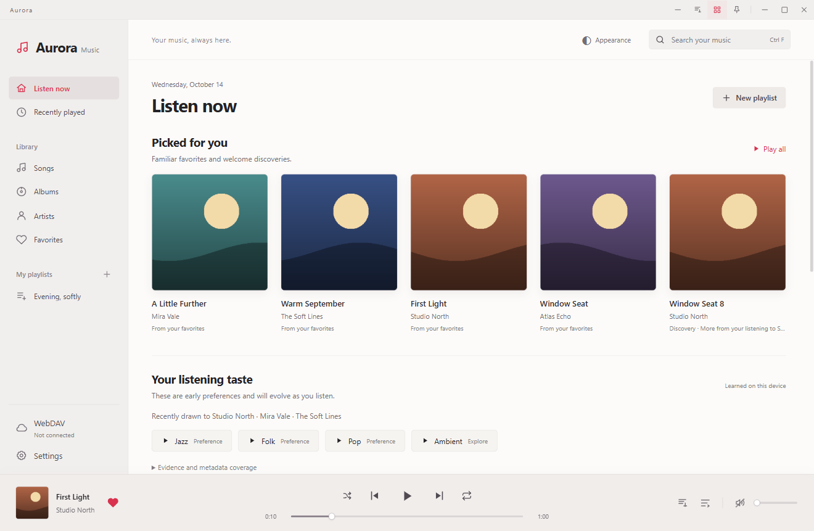

# Aurora Music Next

[简体中文](README.md) · [繁體中文](README.zh-TW.md) · [English](README.en.md) · [Français](README.fr.md)

A Windows WebDAV music player with light and dark themes, local listening preferences and optional AI playlists.

The Android phone/tablet preview and Android Studio build steps are in the [Android guide](docs/android/guide.en.md). Native playback, offline storage, themes, widgets and optional AI playlists are implemented; full desktop parity and Xiaomi device acceptance are still pending. This is not a stable Android release.

## Features

- WebDAV browsing and recursive indexing; search, albums and artists.
- Queue, favourites, recent listening, playlists, synchronised lyrics and keyboard shortcuts.
- Local FFmpeg compatibility decoding for M4A / MP4 / ALAC without modifying remote files.
- Behaviour-based recommendations and optional AI scene understanding, with full-library retrieval before candidate selection.
- DeepSeek, OpenAI-compatible, Anthropic and Gemini services with ordered fallback.
- Lyrics, artwork and background search with explicit preview and apply.
- Simplified Chinese, Traditional Chinese, English and French; persistent language selection.

## Get started

Read the [illustrated guide](docs/guides/en.md). See [CONTRIBUTING](CONTRIBUTING.md) for development and local builds.

[Download 1.5.0-preview.12](https://github.com/nanfengking/Aurora-music-next/releases/tag/v1.5.0-preview.12) · [Release notes](docs/releases/1.5.0-preview.12.md)

This preview includes an Android APK and the complete Windows/Android application source. Android improves durable settings, language restoration, cold-start playback and widget controls. The APK retains the previous preview signing identity; install over the existing preview without uninstalling it first. Windows installers are deferred until the matching FFmpeg source and build materials are available. See [SECURITY](SECURITY.md) and [third-party notices](THIRD_PARTY_NOTICES.md).

## Privacy and publishing

Screenshots contain fictional demo tracks, artists, artwork and history. The source archive excludes credentials, real libraries, caches, installers and the FFmpeg executable. Read [PRIVACY](PRIVACY.md) for network boundaries.

Credentials, listening history and offline files stay outside the source distribution. Report problems with the application version, platform and reproduction steps, omitting account details and private URLs.

Copyright © 2026 jinlaoshi. Original project code: [GPL-3.0-only](LICENSE). Third-party components retain their own licences. by jinlaoshi
