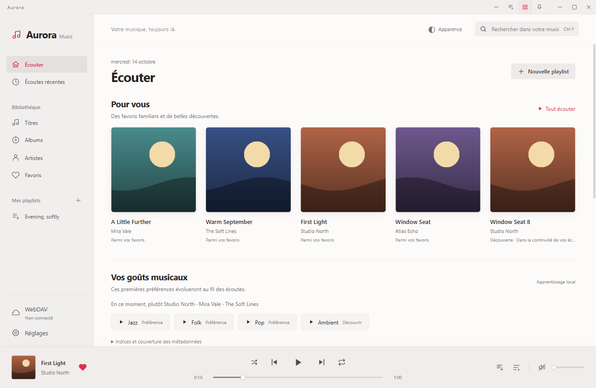

# Aurora Music Next

[简体中文](README.md) · [繁體中文](README.zh-TW.md) · [English](README.en.md) · [Français](README.fr.md)

Un lecteur musical WebDAV pour Windows : thèmes clair et sombre, préférences d’écoute locales et playlists assistées par IA, en option.

L’aperçu Android pour téléphone/tablette et la compilation dans Android Studio sont décrits dans le [guide Android](docs/android/guide.fr.md). Lecture native, stockage hors ligne, thèmes, widgets et IA facultative sont implémentés. La parité complète et les essais Xiaomi restent à faire ; ce n’est pas une version Android stable.

## Fonctionnalités

- Navigation WebDAV, indexation récursive, recherche, albums et artistes.
- File d’attente, favoris, écoutes récentes, playlists, paroles synchronisées et raccourcis.
- Décodage local compatible M4A / MP4 / ALAC avec FFmpeg, sans modifier les fichiers distants.
- Recommandations selon les écoutes ; compréhension des demandes par IA après recherche dans toute la bibliothèque.
- DeepSeek, services compatibles OpenAI, Anthropic et Gemini, avec ordre de priorité et repli.
- Recherche de paroles, pochettes et fonds ; aperçu et application explicite.
- Chinois simplifié, chinois traditionnel, anglais et français ; choix de langue mémorisé.

## Bien démarrer

Consultez le [guide illustré](docs/guides/fr.md) et les [instructions de développement](CONTRIBUTING.md).

[Télécharger 1.5.0-preview.12](https://github.com/nanfengking/Aurora-music-next/releases/tag/v1.5.0-preview.12) · [Notes de version](docs/releases/1.5.0-preview.12.md)

Cet aperçu fournit l’APK Android et le code source complet de l’application Windows/Android. Il améliore l’enregistrement des préférences, la restauration de la langue, le démarrage à froid et les commandes des widgets. L’APK conserve la signature de l’aperçu précédent : installez-le par-dessus sans désinstaller l’application. L’installateur Windows sera proposé après préparation des sources et des éléments de compilation correspondant à FFmpeg. Voir [SECURITY](SECURITY.md) et les [mentions tierces](THIRD_PARTY_NOTICES.md).

## Confidentialité et publication

Les captures utilisent uniquement des morceaux, artistes, images et historiques fictifs. L’archive source exclut identifiants, bibliothèque réelle, caches, installateurs et exécutable FFmpeg. Voir [PRIVACY](PRIVACY.md).

Pour signaler un problème, indiquez la version, le système et les étapes de reproduction, sans identifiants, URL privées ni clés.

Copyright © 2026 jinlaoshi. Code original sous [GPL-3.0-only](LICENSE). Les composants tiers conservent leurs licences. by jinlaoshi
