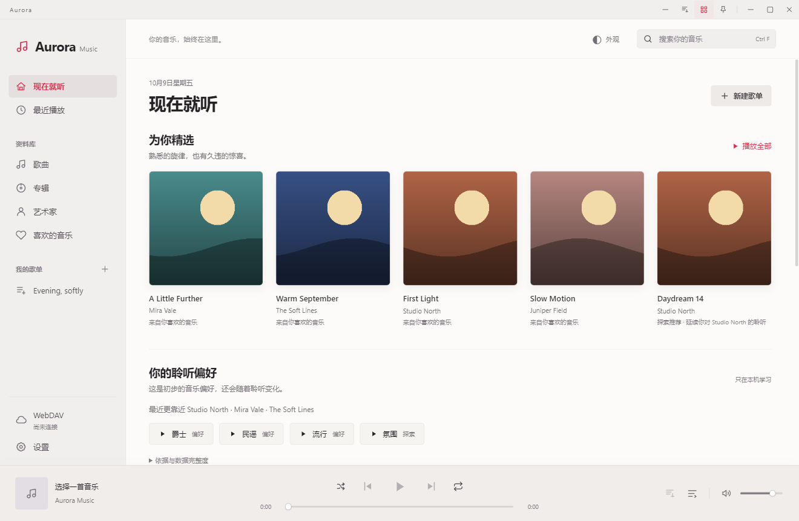

# Aurora Music Next

[简体中文](README.md) · [繁體中文](README.zh-TW.md) · [English](README.en.md) · [Français](README.fr.md)

一个面向 Windows/安卓 的 WebDAV 音乐播放器。明亮与深色主题、本地聆听偏好、可选 AI 歌单；音乐与收藏仍由你掌握。

Android 手机／平板预览版与 Android Studio 编译指南见 [README.android.md](README.android.md)。已支持原生后台播放、离线、主题、小组件及混合 AI 歌单。

## 功能

- WebDAV 目录浏览、递归曲库索引、搜索、专辑与艺术家视图。
- 播放队列、收藏、最近播放、普通歌单、同步歌词与键盘快捷键。
- M4A / MP4 / ALAC 本机 FFmpeg 兼容解码，不修改远端音频。
- 根据收藏、听完与跳过行为推荐；AI 可理解场景并从全曲库筛选的候选中编排歌单。
- DeepSeek / OpenAI 兼容（Chat Completions、Responses）/ Anthropic / Gemini，多服务优先级与失败回退。
- 可选自动歌词和封面查找；背景由封面放大模糊生成，也支持手动确认资源。
- 音质与输出设备信息面板、Windows 同系列覆盖安装与手动确认的应用内更新。
- 简体中文、繁體中文、English、Français，切换后自动记住。

## 开始使用

阅读[带图片的使用指南](docs/guides/zh-CN.md)。开发与本机构建见 [CONTRIBUTING](CONTRIBUTING.md)。

## 下载与更新

[下载 1.5.0-preview.12](https://github.com/nanfengking/Aurora-music-next/releases/tag/v1.5.0-preview.12) · [本次更新](docs/releases/1.5.0-preview.12.md)

本次提供 Android APK 和 Windows／Android 完整源码。Android 改进设置保存、语言恢复、冷启动播放和小组件控制。预览包沿用此前的调试签名；安装前请保留现有应用，直接覆盖安装。

Windows 源码已同步更新，安装包待 FFmpeg 对应源码与构建材料补齐后另行提供。安全状态见 [SECURITY](SECURITY.md)，组件许可见 [第三方说明](THIRD_PARTY_NOTICES.md)。

## 隐私与开源

演示图中的艺术家、歌曲、封面和历史均为虚构测试数据。源码包不包含账号、真实曲库、缓存、安装器或 FFmpeg 可执行文件。API 仅在你主动启用相应功能时接收必要信息；见 [PRIVACY](PRIVACY.md)。

Copyright © 2026 jinlaoshi. 项目原创代码采用 [GPL-3.0-only](LICENSE)；第三方组件遵循各自许可证。by jinlaoshi
