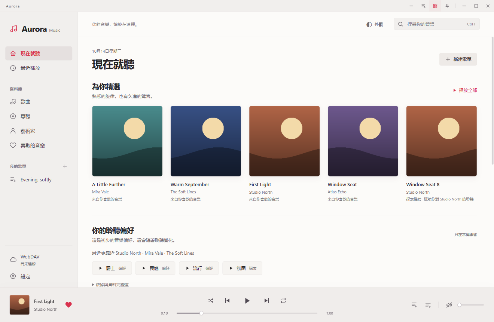

# Aurora Music Next

[簡體中文](README.md) · [繁體中文](README.zh-TW.md) · [English](README.en.md) · [Français](README.fr.md)

一個面向 Windows 的 WebDAV 音樂播放器。明亮與深色主題、本地聆聽偏好、可選 AI 歌單；音樂與收藏仍由你掌握。

Android 手機／平板預覽版與 Android Studio 編譯步驟見 [Android 指南](docs/android/guide.zh-TW.md)。已實作原生播放、離線儲存、主題、小工具與選用 AI 歌單；完整桌面功能對齊及小米實機驗收仍待完成，不是 Android 穩定版。

## 功能

- WebDAV 目錄瀏覽、遞迴曲庫索引、搜尋、專輯與藝術家檢視。
- 播放佇列、收藏、最近播放、普通歌單、同步歌詞與鍵盤快捷鍵。
- M4A / MP4 / ALAC 本機 FFmpeg 相容解碼，不修改遠端音訊。
- 根據收藏、聽完與跳過行為推薦；AI 可理解場景並從全曲庫篩選的候選中編排歌單。
- DeepSeek / OpenAI 相容 / Anthropic / Gemini，多服務優先順序與失敗回退。
- 歌詞、封面和背景檢索，預覽後手動應用。
- 簡體中文、繁體中文、English、Français，切換後自動記住。

## 開始使用

閱讀[帶圖片的使用指南](docs/guides/zh-TW.md)。開發與本機構建見 [CONTRIBUTING](CONTRIBUTING.md)。

[下載 1.5.0-preview.12](https://github.com/nanfengking/Aurora-music-next/releases/tag/v1.5.0-preview.12) · [本次更新](docs/releases/1.5.0-preview.12.md)

本次提供 Android APK 及 Windows／Android 完整原始碼，改善設定儲存、語言恢復、冷啟動播放和小工具控制。APK 沿用先前預覽版的簽章，可直接覆蓋安裝，請勿先解除安裝。Windows 安裝包待 FFmpeg 對應原始碼與建置材料補齊後另行提供。安全狀態見 [SECURITY](SECURITY.md)，元件授權見[第三方說明](THIRD_PARTY_NOTICES.md)。

## 隱私與開源

演示圖中的藝術家、歌曲、封面和歷史均為虛構測試資料。原始碼包不包含賬號、真實曲庫、快取、安裝器或 FFmpeg 執行檔。API 僅在你主動啟用相應功能時接收必要資訊；見 [PRIVACY](PRIVACY.md)。

回報問題時請提供應用版本、系統和重現步驟，並遮住帳號、私有網址與金鑰。

Copyright © 2026 jinlaoshi. 專案原創程式碼採用 [GPL-3.0-only](LICENSE)；第三方元件遵循各自許可證。by jinlaoshi
